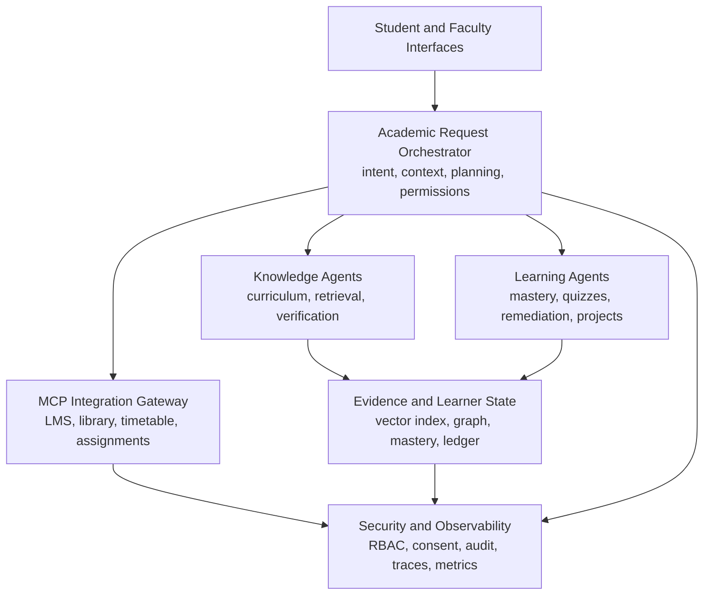

# CampusGenie System Architecture

CampusGenie is organized as a layered, testable system. The first release is a runnable Next.js prototype with provider-neutral TypeScript contracts. A production deployment can move the orchestration and ingestion services behind FastAPI without changing the learner-facing response contract.

## Layers

## Current implementation map

| Architecture layer | Current location | Responsibility |
| --- | --- | --- |
| Student interface | `app/page.tsx` | Dashboard, study mission, learner signal, evidence trail |
| Request boundary | `app/api/assistant/route.ts` | Typed request/response boundary; deterministic MVP response |
| Curriculum state | `lib/curriculum/types.ts` | Topics, prerequisites, mastery bands, evidence links |
| Retrieval | `lib/rag/contracts.ts` | Hybrid retriever interface and provenance-bearing evidence |
| Agent orchestration | `lib/ai/contracts.ts` | Intent, agent capability, response composition contracts |
| Institutional tools | `lib/mcp/contracts.ts` | MCP tool discovery, scoped calls, action receipts |
| Security | `lib/security/contracts.ts` | Roles, permissions, consent, immutable trace shape |
| Evaluation | `lib/evaluation/contracts.ts` | Accuracy, satisfaction, completion, latency, learning gain |

## Recommended production topology

The MVP uses one Next.js application to reduce setup friction. Once institutional integrations and document ingestion become real workloads, split the system into:

1. **Web application:** React interface and authenticated API client.
2. **Orchestration API:** FastAPI service owning request planning, policy checks, and agent state transitions.
3. **Knowledge service:** document ingestion, chunking, embeddings, hybrid retrieval, and curriculum graph updates.
4. **Learning state service:** PostgreSQL records for learner state, quiz attempts, consent, and outcome events.
5. **MCP gateway:** dedicated Python MCP servers for LMS, library, timetable, and approved project systems.
6. **Evaluation worker:** asynchronous benchmark and telemetry processing using Redis-backed jobs.

PostgreSQL with `pgvector` is the recommended first production datastore. Use a simple adjacency-list curriculum graph for the MVP; introduce Neo4j only when cross-course prerequisite traversal and graph analytics justify the operational cost.

## Request workflow

1. Authenticate the user and resolve role, learner identity, course context, and consent.
2. Classify intent and risk: explain, plan, quiz, project, or institutional action.
3. Read the curriculum graph and learner-state confidence for relevant topics.
4. Select retrieval depth, prerequisite expansion, and agent sequence.
5. Retrieve evidence with source, version, access policy, and topic metadata.
6. Generate a response or artifact with citations and a proposed next action.
7. Verify factual support, curriculum alignment, academic-integrity policy, and tool authorization.
8. Request confirmation for consequential MCP writes; record a tool-call receipt.
9. Capture feedback, task completion, quiz results, and instructor corrections.
10. Update learner state only from evidence-linked outcome events.

## Technology decisions

| Concern | MVP | Production direction |
| --- | --- | --- |
| UI | Next.js React + Tailwind | Keep, or split into React + Vite if independently deployed |
| API | Next route boundary | FastAPI orchestration service |
| Agent state | Typed contracts | LangGraph or an explicit state machine |
| Retrieval | Mock evidence | PostgreSQL + pgvector plus keyword and graph retrieval |
| Curriculum graph | In-memory typed data | PostgreSQL adjacency lists, then Neo4j if needed |
| MCP | Tool contracts | Python MCP SDK and dedicated least-privilege servers |
| Background work | Synchronous MVP | Redis and a task queue for ingestion/evaluation |
| Evaluation | Contract only | pytest benchmarks and controlled baseline comparisons |

## Security baseline

- Treat every MCP server as a capability boundary, not as a trusted extension of the model.
- Separate read and write tools; require explicit confirmation for writes.
- Enforce role, resource, course, and consent checks before retrieval and tool calls.
- Log agent traces, retrieved evidence, tool parameters, results, and policy decisions.
- Do not use student interaction data for evaluation or model improvement without recorded consent.
- Keep official grades, disciplinary records, and enrollment actions outside autonomous writes.

## Patent-oriented technical boundary

The potentially defensible engineering contribution is not the use of an LLM, RAG, MCP, or a quiz generator in isolation. Preserve evidence of the combined mechanism: learner mastery uncertainty and curriculum prerequisites jointly control retrieval expansion and agent routing; institutional tool permissions constrain the plan; verified outcomes update the learner state and change the next planned action. Prior-art review and patent counsel are required before filing.